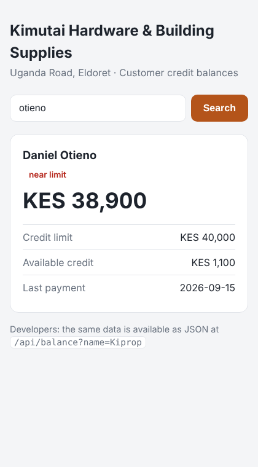
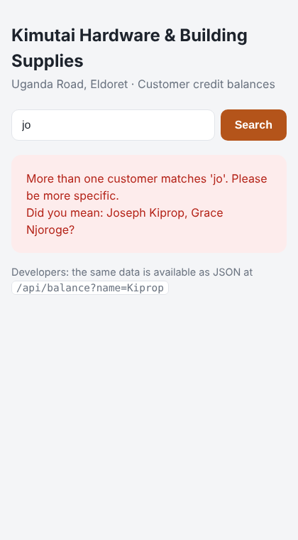

# Hardware Shop Credit Tracker

A small Flask web app for a hardware shop in Eldoret that sells on credit. The owner types a customer's name and instantly sees how much they owe, their credit limit, the credit still available and their last payment date, instead of flipping through the credit notebook.

AI Masterclass 2, Week 4, Day 16: Flask basics.

**What I'd charge:** KES 10,000 one-off to set it up on the shop's computer with their customer list entered, plus KES 1,500 per month if they want balance updates and support.

## Routes

| Route | Returns | Example |
|---|---|---|
| `/` | HTML page with the shop name and a search form | `http://127.0.0.1:5000/` |
| `/api/balance?name=...` | The customer's balance as JSON | `/api/balance?name=Kiprop` |

Partial names work ("kiprop" finds Joseph Kiprop), and capitals and extra spaces are ignored.

Example response:
```json
{
  "name": "Joseph Kiprop",
  "balance_kes": 12450,
  "credit_limit_kes": 30000,
  "available_credit_kes": 17550,
  "last_payment": "2026-10-28",
  "status": "owing"
}
```

`status` is `cleared` (owes nothing), `owing`, or `near limit` (80% or more of the credit limit used).

## Status codes

| Code | When |
|---|---|
| 200 | Customer found |
| 400 | Name missing, too short (under 2 letters), or matches more than one customer (the response lists the matches) |
| 404 | No customer with that name, or a page that doesn't exist |

## Setup and run

```bash
pip install -r requirements.txt
python app.py
```

Open **http://127.0.0.1:5000** in your browser. Press **Ctrl+C** in the terminal to stop the server.

To run with Flask's debug mode (auto-reload while developing):
```bash
FLASK_DEBUG=1 python app.py
```

## Screenshots

| Customer found | More than one match |
|---|---|
|  |  |

## Sample customers

Joseph Kiprop, Mary Chebet, Daniel Otieno, Faith Jepkosgei, Peter Wafula and Grace Njoroge (fictional data, in the `CUSTOMERS` dictionary in `app.py`).

## Before using this in a real shop

- **Keep it on the shop's computer.** It has no login, so it must not be put on the internet as it is. Anyone with the link could see customers' debts.
- **Move the data out of the code.** A real shop needs balances stored in a spreadsheet or database, plus a page to record new credit sales and payments.
